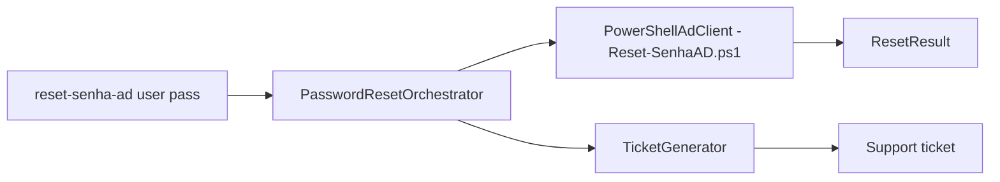

# reset-senha-ad-automacao

**English** · [Português (Brasil)](README.md)

[](#) [](#) [](LICENSE)

## What it is

**Active Directory password-reset automation**: a **Python CLI** that orchestrates resetting a user's password (via **PowerShell AD**, with a replaceable client) and **generates a support ticket** for every attempt — including failures, to keep the trail in the queue. It is an educational IT-support automation lab.

## Status

An educational lab, working and tested (8 tests).

## Features

- **Orchestrator** (`orchestrator.py`): `PasswordResetOrchestrator.reset(username, new_password)` — validates input, runs the reset and produces a `ResetResult`.
- **AD client** (`ad_client.py`): the `AdClient` protocol + the `PowerShellAdClient` implementation (calls the `src/Reset-SenhaAD.ps1` script); injectable client for tests.
- **Ticket** (`ticket.py`): `TicketGenerator.generate` creates a `Ticket` with an id and action (`password_reset`).
- **CLI**: `reset-senha-ad <username> <new_password> [--resolved-by suporte-ti]`.

## Architecture

A `reset_senha_ad` package with `orchestrator` (coordination), `ad_client` (AD integration via PowerShell), `ticket` (tracking), `models` (dataclasses) and `cli`. The real reset requires a Windows environment with the ActiveDirectory module; tests use a fake client.



## Stack

- Python ≥ 3.10, stdlib only
- PowerShell 5.1 + the ActiveDirectory module (for the real reset)
- pytest (dev)

## Repository layout

```
reset-senha-ad-automacao/
├── pyproject.toml · BRIEF.md
├── src/Reset-SenhaAD.ps1          # PowerShell script called by the client
├── src/reset_senha_ad/
│   ├── orchestrator.py  # reset + ticket coordination
│   ├── ad_client.py     # protocol + PowerShell implementation
│   ├── ticket.py · models.py · cli.py
├── tests/               # 8 tests
└── LICENSE              # MIT
```

## Prerequisites and installation

```bash
pip install -e .
```

## How to run

```bash
reset-senha-ad maria.silva "StrongNewPass!123" --resolved-by suporte-ti
```
The real reset requires being on a Windows domain with RSAT/ActiveDirectory installed.

## Tests and quality

Real command (verified by the agent):

```bash
PYTHONPATH=src python -m pytest tests/
# 8 passed
```

## Technical decisions and trade-offs

- **AD client as an injectable Protocol**: testable without a real domain; the PowerShell implementation talks to AD for real.
- **Ticket always generated** (even on failure): preserves the audit trail in the support queue.

## Known limitations and roadmap

- Does not validate the domain password policy before attempting.
- No authentication of its own: whoever runs the CLI needs AD permission to reset passwords.

## Development process

An individual project by Kelvin Oliveira, built with orchestrated AI agents and reviewed by the author.

## License and author

MIT — Copyright (c) 2026 Kelvin Rebelo de Oliveira. Author: [Kelvin Oliveira](https://github.com/KelvinOliveiraCode) · [Portfolio](https://kelvinoliveiracode.github.io/portfolio/)
