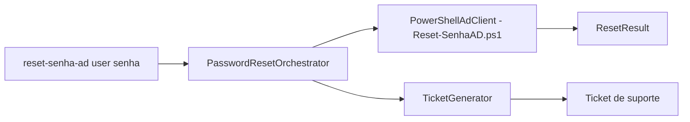

# reset-senha-ad-automacao

[English](README.en.md) · **Português (Brasil)**

[](#) [](#) [](LICENSE)

## O que é

**Automação de reset de senha do Active Directory**: uma **CLI em Python** que orquestra o reset da senha de um usuário (via **PowerShell AD**, cliente substituível) e **gera um ticket de suporte** para cada tentativa — inclusive as que falham, para manter o rastro na fila. É um laboratório educacional de automação de Suporte TI.

## Status

Laboratório educacional funcional e testado (8 testes).

## Funcionalidades

- **Orquestrador** (`orchestrator.py`): `PasswordResetOrchestrator.reset(username, new_password)` — valida entrada, executa o reset e gera o `ResetResult`.
- **Cliente AD** (`ad_client.py`): protocolo `AdClient` + implementação `PowerShellAdClient` (chama o script `src/Reset-SenhaAD.ps1`); cliente injetável para testes.
- **Ticket** (`ticket.py`): `TicketGenerator.generate` cria um `Ticket` com id e ação (`password_reset`).
- **CLI**: `reset-senha-ad <username> <new_password> [--resolved-by suporte-ti]`.

## Arquitetura

Pacote `reset_senha_ad` com `orchestrator` (coordenação), `ad_client` (integração AD via PowerShell), `ticket` (rastreio), `models` (dataclasses) e `cli`. O reset real depende de um ambiente Windows com o módulo ActiveDirectory; os testes usam um cliente fake.



## Stack

- Python ≥ 3.10, stdlib apenas
- PowerShell 5.1 + módulo ActiveDirectory (para o reset real)
- pytest (dev)

## Estrutura do repositório

```
reset-senha-ad-automacao/
├── pyproject.toml · BRIEF.md
├── src/Reset-SenhaAD.ps1          # script PowerShell chamado pelo cliente
├── src/reset_senha_ad/
│   ├── orchestrator.py  # coordenação reset + ticket
│   ├── ad_client.py     # protocolo + impl PowerShell
│   ├── ticket.py · models.py · cli.py
├── tests/               # 8 testes
└── LICENSE              # MIT
```

## Pré-requisitos e instalação

```bash
pip install -e .
```

## Como executar

```bash
reset-senha-ad maria.silva "NovaSenhaForte!123" --resolved-by suporte-ti
```
O reset real exige estar num domínio Windows com RSAT/ActiveDirectory instalado.

## Testes e qualidade

Comando real (verificado pelo agente):

```bash
PYTHONPATH=src python -m pytest tests/
# 8 passed
```

## Decisões técnicas e trade-offs

- **Cliente AD como Protocol injetável**: testável sem domínio real; a impl PowerShell chama o AD de verdade.
- **Ticket sempre gerado** (mesmo em falha): preserva o rastro de auditoria na fila de suporte.

## Limitações conhecidas e roadmap

- Não valida a política de senha do domínio antes de tentar.
- Sem autenticação própria: quem executa a CLI precisa de permissão para resetar senhas no AD.

## Processo de desenvolvimento

Projeto individual de Kelvin Oliveira, construído com agentes de IA orquestrados e revisado pelo autor.

## Licença e autor

MIT — Copyright (c) 2026 Kelvin Rebelo de Oliveira. Autor: [Kelvin Oliveira](https://github.com/KelvinOliveiraCode) · [Portfólio](https://kelvinoliveiracode.github.io/portfolio/)
